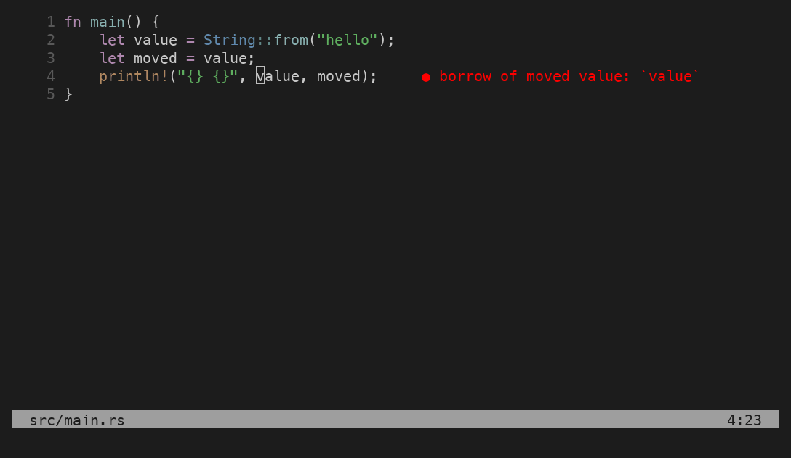
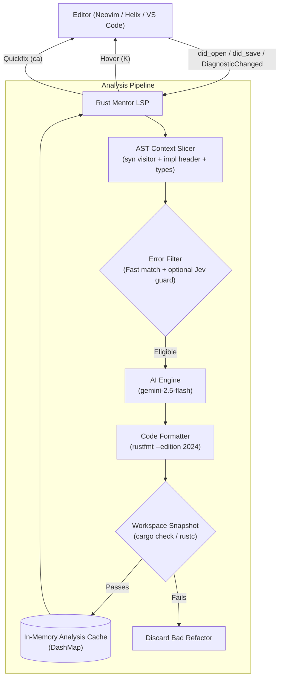

<div align="center">

# 🦀 Rust Mentor LSP

**A compiler-verified companion Language Server for Rust borrow-checker, ownership, and lifetime diagnostics.**

[](LICENSE)
[](https://www.rust-lang.org/)
[](https://microsoft.github.io/language-server-protocol/)

<p align="center">
  Runs quietly alongside <code>rust-analyzer</code> in your editor. Pre-caches ultra-concise explanations in Hover (<code>K</code>) and delivers <code>rustc</code>-verified code refactors in Code Actions (<code>&lt;leader&gt;ca</code>).
</p>

---

</div>

## 💡 The Problem

The Rust borrow checker is renowned for ensuring memory safety without a garbage collector. However, deciphering ownership moves, simultaneous borrows, and lifetime mismatch errors can be daunting for learners and frustrating even for experienced engineers.

Standard chat-based AI plugins disrupt flow by requiring manual copy-pasting, generating long explanatory essays, and frequently proposing code that fails compilation or defaults to expensive `.clone()` calls.

**`rust-mentor-lsp` takes a fundamentally different approach:**
1. **Native LSP Companion:** It connects directly to your editor alongside `rust-analyzer`.
2. **Surgical AST Slicing:** It extracts the enclosing function, its `impl` header, and local type definitions using `syn`.
3. **Compiler-Verified Quickfixes:** Proposed fixes are formatted and checked in an isolated Cargo workspace copy (or with `rustc` for standalone files). A fix is offered only when the check succeeds and the target function is confirmed to participate in compilation. Failed or unavailable checks leave the explanation available without a quickfix.
4. **Ultra-Concise Hover Tooltips:** You get exactly two single-sentence bullet points—explaining the violation and how to resolve it idiomatically.

---

## 📸 Visual Showcase



*Recorded from a live Neovim session with Rust Mentor LSP. Keybindings match the [Editor Setup](#editor-setup).*

| Step | You do | Rust Mentor does |
| :--- | :--- | :--- |
| **1 · Find** | Open or save a file with an ownership error. | Analyzes eligible diagnostics in the background. |
| **2 · Understand** | Hover on the error with `K` after analysis completes. | Shows a short **Why / Fix** explanation and, when available, a checked replacement. |
| **3 · Review** | Open code actions with `<leader>ca`. | Rechecks the proposed fix against the current workspace. |
| **4 · Apply** | Choose **Apply Verified Rust Mentor Refactor (E0382)**. | Replaces the function using a document-versioned edit. |

<details>
<summary><strong>Copy the example: before → after</strong></summary>

**Before — ownership moves into `moved`, then `value` is used again:**

```rust
fn main() {
    let value = String::from("hello");
    let moved = value;
    println!("{} {}", value, moved); // E0382
}
```

**After — borrowing keeps `value` available:**

```rust
fn main() {
    let value = String::from("hello");
    let moved = &value;
    println!("{} {}", value, moved);
}
```

Try the broken version in a standalone file or a new Cargo project's `src/main.rs`. If verification fails or cannot run, only the explanation is offered. Compiler acceptance does not guarantee behavioral equivalence; review the change before applying it.

</details>

---

## 💸 Error Cost Calculator

**Example budget: 1,000 fresh analyses ≈ $2.10** with 2,000 input tokens and 600 output tokens per request. These are illustrative token sizes, not measured averages or a fixed price per error.

The configured model is `gemini-2.5-flash`, with thinking disabled. Paid-tier text rates used here are **$0.30 / million input tokens** and **$2.50 / million output tokens**, checked November 9, 2026. [Google's Gemini Developer API pricing](https://ai.google.dev/gemini-api/docs/pricing#gemini-2.5-flash).

| Illustrative request size | Input tokens | Output tokens | One analysis | 1,000 analyses | 10,000 analyses |
| :--- | ---: | ---: | ---: | ---: | ---: |
| Small function | 800 | 250 | $0.000865 | $0.865 | $8.65 |
| Medium function | 2,000 | 600 | $0.002100 | $2.10 | $21.00 |
| Larger context | 8,000 | 1,800 | $0.006900 | $6.90 | $69.00 |

### Calculate your own usage

Run the [offline calculator](scripts/estimate_cost.py) with Python 3. It needs no API key or dependencies and makes no network requests:

```bash
# Default example: 1,000 errors, one fresh analysis each → $2.10
python3 scripts/estimate_cost.py --errors 1000

# Three analysis attempts per error, 40% served locally → $3.78
python3 scripts/estimate_cost.py --errors 1000 \
  --analyses-per-error 3 --cache-hit-rate 40

# Monthly example: 100 errors/day × 22 working days → $4.62
python3 scripts/estimate_cost.py --errors 2200 \
  --input-tokens 2000 --output-tokens 600

# Override rates if pricing changes
python3 scripts/estimate_cost.py --errors 1000 \
  --input-rate 0.30 --output-rate 2.50
```

Default output:

```text
Rust Mentor · Gemini paid-tier estimate (USD)
Expected model requests: 1,000.00
Cost per model request:  $0.002100
Estimated total:         $2.1000
Excludes optional Jev charges, taxes, and local compute. Not measured usage.
```

<details>
<summary><strong>Formula and what counts as a paid request</strong></summary>

```text
requests = errors × analyses_per_error × (1 − cache_hit_rate / 100)
cost     = requests × (input_tokens × input_rate + output_tokens × output_rate) / 1,000,000
```

- **Count eligible errors sent for analysis**, not every compiler diagnostic. Repeat analysis after edits can generate another request for the same underlying error.
- **Input tokens include the full prompt:** instructions, compiler diagnostic, local types, numbered context, and the original function. The current prompt includes the function in both context and replacement instructions.
- **Output tokens include the explanation and the complete replacement function**, not just the changed lines. Rejected fixes still consumed a model request.
- **Local cache hits skip Gemini entirely.** This is the server's in-memory cache, not Google's paid context-caching service. Buffer lifecycle events invalidate cached analysis; do not assume a high hit rate without measuring it.
- **Hovering over cached results and locally rechecking a quickfix add no Gemini token charges.** Compiler checks still consume local resources.
- **Optional Jev filtering is excluded.** If enabled, account for that service separately and estimate Gemini requests after filtering. Free-tier eligibility and limits depend on your provider account; the calculator uses paid-tier rates by default.

This server does not currently report actual token usage or billing. Use your provider's usage dashboard to refine these inputs. Rates are editable through `--input-rate` and `--output-rate`; `--help` lists all options.

</details>

---

## 🏗️ Architecture



---

## ✨ Features

- ⚡ **Cached Hover:** Diagnostics are pre-cached in the background on file open, save, and editor diagnostic events.
- 🛡️ **`rustc`-Verified Fixes:** Proposed refactors are checked in temporary workspace copies with isolated Cargo targets. Standalone files are checked with `rustc` in normal and test configurations. Quickfixes are rechecked when requested.
- 🧠 **Smart Context Slicing:** Recursively parses nested modules (`#[cfg(test)] mod tests`), `impl` blocks, and `trait` definitions without sending entire large files to the AI model.
- 📐 **Format & Indentation Preservation:** Function spans preserve adjacent code and attributes; edit positions use UTF-16, and document-versioned edits protect newer buffer contents.
- 🚦 **Concurrency & Rate-Limiting:** Background AI generation is limited to two concurrent analyses. This bounds concurrency; it is not a requests-per-minute quota limiter.
- 🔒 **Zero Code Annotations:** Never writes unwanted inline comments or AI markers into your source files.

---

## 🎯 Which Issues Does It Help With?

`rust-mentor-lsp` is intentionally designed as a **companion** to `rust-analyzer`, not a replacement. 

### The Division of Labor
* **Trivial Syntax & Imports (Handled by `rust-analyzer`):** Missing semicolons, typos in variable names, and missing `use` imports (`E0432`, `E0433`) are handled natively by `rust-analyzer` in 1 millisecond. Running an LLM for these is unnecessary.
* **Architectural & Ownership Puzzles (Handled by `rust-mentor-lsp`):** When the compiler rejects your borrowing patterns, lifetimes, moves, or thread-safety trait bounds, `rust-analyzer` only displays the raw error. `rust-mentor-lsp` steps in to explain *why* the ownership rule broke and provides a compiler-verified, idiomatic refactor.

---

### Built-in Error Codes

The server out-of-the-box intercepts **15 foundational compiler errors** grouped into four categories:

#### 1. Borrowing & Aliasing
| Error Code | Description | Typical Scenario |
| :--- | :--- | :--- |
| `E0502` | Simultaneous mutable & immutable borrow | Reading from a collection while mutating it |
| `E0499` | Multiple mutable borrows | Borrowing a struct mutably more than once concurrently |
| `E0503` | Use of value while borrowed mutably | Reading a variable while an exclusive reference is active |
| `E0506` | Assignment to borrowed value | Overwriting a binding while it is currently referenced |
| `E0596` | Cannot borrow as mutable | Attempting to mutate through an immutable binding |
| `E0716` | Temporary value dropped while borrowed | Taking a reference to a temporary expression that drops immediately |

#### 2. Ownership & Transfers
| Error Code | Description | Typical Scenario |
| :--- | :--- | :--- |
| `E0382` | Use of moved value | Accessing a variable after its ownership was transferred |
| `E0505` | Move out of value while borrowed | Moving data while an outstanding borrow points to it |
| `E0507` | Move out of shared reference | Attempting to move non-`Copy` data out of `&T` or `&self` |
| `E0515` | Return reference to local variable | Returning a pointer or slice to stack memory allocated in the function |

#### 3. Lifetimes & Closures
| Error Code | Description | Typical Scenario |
| :--- | :--- | :--- |
| `E0106` | Missing lifetime specifier | Function signatures requiring explicit lifetime relationship annotations |
| `E0521` | Lifetime requirement violated | Borrowed data outliving its declared lifetime parameter |
| `E0597` | Borrowed value does not live long enough | Reference outliving an inner block or temporary value |
| `E0373` | Closure captures variable by reference | A closure or `async` block outliving local variables (missing `move`) |

#### 4. Type System & Trait Bounds
| Error Code | Description | Typical Scenario |
| :--- | :--- | :--- |
| `E0277` | Trait bound not satisfied | Missing traits like `Clone`, `Display`, `Send`, or `Sync` across thread boundaries |

---

## 🔧 Configuring Additional Error Codes

You are not restricted to the built-in list. You can configure `rust-mentor-lsp` to intercept **any** `rustc` compiler error.

### Method 1: Zero-Recompile via Environment Variable (Recommended)

You can tell `rust-mentor-lsp` to handle additional errors without recompiling the binary. Set `RUST_MENTOR_EXTRA_ERROR_CODES` in your `~/.config/rust-mentor/.env` or project `.env`:

```bash
# Add type mismatches (E0308), missing methods (E0599), and non-exhaustive matches (E0004)
RUST_MENTOR_EXTRA_ERROR_CODES=E0308,E0599,E0004
```

#### Popular Codes to Add:
* `E0308`: **Mismatched Types** (e.g., expected `Result<T, E>`, found `Option<T>`, or `&str` vs `String`).
* `E0599`: **No Method Named Found** (usually a missing `use` trait in scope, or calling a method on `&T` instead of `&mut T`).
* `E0004`: **Non-Exhaustive Patterns** (unhandled arms in `match` statements).
* `E0384`: **Cannot Assign Twice to Immutable Variable** (reassignment vs `mut`).
* `E0782`: **Trait Objects Require `dyn`** (migrating to dynamic dispatch).

### Method 2: Customizing in Source Code

If you are maintaining a custom fork, you can permanently add codes in [`src/filter.rs`](src/filter.rs):

```rust
pub fn is_candidate_error_code(code: &str) -> bool {
    if matches!(
        code,
        "E0106"
            | "E0277"
            | "E0373"
            | "E0382"
            | "E0499"
            | "E0502"
            | "E0503"
            | "E0505"
            | "E0506"
            | "E0507"
            | "E0515"
            | "E0521"
            | "E0596"
            | "E0597"
            | "E0716"
            // Add your new codes here:
            | "E0308"
            | "E0599"
            | "E0004"
    ) {
        return true;
    }
    // ...
}
```

Additional codes use the same explanation and verification pipeline. Quickfixes require an unambiguous enclosing function and a successful compiler check; errors that require edits elsewhere may receive only an explanation.

---

## 📋 Prerequisites & Requirements

1. **Rust Toolchain:** Stable Rust with `rustc`, `cargo`, and `rustfmt` installed (`rustup default stable`).
2. **`rust-analyzer`:** Installed and running as your primary LSP server (`rustup component add rust-analyzer`).
3. **Gemini API Key:** A Google Gemini API key (Free tier available at [Google AI Studio](https://aistudio.google.com/)).
4. *(Optional)* **TypeSafe AI Key:** If you wish to use Jev neural gating (`TYPESAFE_API_KEY`). If omitted, the built-in 0ms rule filter is used.

---

## 🚀 Installation

### 1. Build & Install Binary

Clone this repository and install the binary with Cargo:

```bash
git clone https://github.com/nyrx-dev/rust-mentor-lsp.git
cd rust-mentor-lsp
cargo install --path .
```

This installs `rust-mentor-lsp` to `~/.cargo/bin/rust-mentor-lsp`. Ensure `~/.cargo/bin` is in your `$PATH`.

Alternatively, build a release binary locally:

```bash
cargo build --release
# Executable located at: ./target/release/rust-mentor-lsp
```

### 2. Configure API Keys

You can configure your API key globally so it is available across all projects:

```bash
mkdir -p ~/.config/rust-mentor
cat << 'EOF' > ~/.config/rust-mentor/.env
GEMINI_API_KEY=your_gemini_api_key_here
# Optional:
# TYPESAFE_API_KEY=your_typesafe_key_here
EOF
chmod 600 ~/.config/rust-mentor/.env
```

`rust-mentor-lsp` automatically checks:
1. Process environment variables (`export GEMINI_API_KEY=...`).
2. Current working directory `.env`.
3. Executable directory `.env`.
4. Global config at `~/.config/rust-mentor/.env`.

---

<a id="editor-setup"></a>

## ⚙️ Editor Setup

### Neovim

#### Option A: Neovim 0.11+ / 0.12 Native API (`vim.lsp.config`)

Add `rust_mentor` alongside `rust_analyzer` in your LSP configuration (e.g., `lua/plugins/lsp-config.lua` or `init.lua`):

```lua
-- 1. Setup rust-analyzer as your primary server
vim.lsp.config('rust_analyzer', {
    filetypes = { 'rust' },
    root_markers = { 'Cargo.toml', '.git' },
    settings = {
        ['rust-analyzer'] = {
            check = { command = 'clippy' },
            cargo = { allFeatures = true },
        },
    },
})
vim.lsp.enable('rust_analyzer')

-- 2. Setup rust_mentor companion LSP
vim.lsp.config('rust_mentor', {
    cmd = { 'rust-mentor-lsp' },
    filetypes = { 'rust' },
    root_markers = { 'Cargo.toml', '.git' },
    on_attach = function(client, bufnr)
        -- Forward compiler diagnostics to rust_mentor for instant background caching
        vim.api.nvim_create_autocmd('DiagnosticChanged', {
            buffer = bufnr,
            callback = function()
                local diags = vim.diagnostic.get(bufnr, { severity = vim.diagnostic.severity.ERROR })
                local payload = {}
                for _, d in ipairs(diags) do
                    if d.code then
                        local msg = (d.user_data and d.user_data.lsp and d.user_data.lsp.data and d.user_data.lsp.data.rendered) or d.message
                        table.insert(payload, {
                            code = tostring(d.code),
                            line = d.lnum,
                            end_line = d.end_lnum or d.lnum,
                            message = msg,
                        })
                    end
                end
                
                local cmd_params = {
                    command = 'rust_mentor.cache_diagnostics',
                    arguments = { vim.uri_from_bufnr(bufnr), payload },
                }
                if client.exec_cmd then
                    client:exec_cmd(cmd_params, { bufnr = bufnr })
                else
                    client:request('workspace/executeCommand', cmd_params, nil, bufnr)
                end
            end,
        })
    end,
    handlers = {
        ['workspace/executeCommand'] = function(err, result)
            if not err and result then
                vim.schedule(function()
                    vim.lsp.buf.hover()
                end)
            end
        end,
    },
})
vim.lsp.enable('rust_mentor')

-- 3. Keybindings
vim.keymap.set('n', 'K', vim.lsp.buf.hover, { desc = 'LSP Hover' })
vim.keymap.set({ 'n', 'v' }, '<leader>ca', function()
    local lnum = vim.api.nvim_win_get_cursor(0)[1] - 1
    local diags = vim.diagnostic.get(0, { lnum = lnum })
    local lsp_diags = {}
    for _, d in ipairs(diags) do
        if d.user_data and d.user_data.lsp then
            table.insert(lsp_diags, d.user_data.lsp)
        elseif d.code then
            table.insert(lsp_diags, {
                range = {
                    start = { line = d.lnum, character = d.col or 0 },
                    ['end'] = { line = d.end_lnum or d.lnum, character = d.end_col or d.col or 0 },
                },
                code = tostring(d.code),
                message = d.message or '',
                severity = d.severity,
            })
        end
    end
    vim.lsp.buf.code_action({ context = { diagnostics = lsp_diags } })
end, { desc = 'Code Action' })
```

#### Option B: Standard `nvim-lspconfig` (Neovim 0.9 / 0.10)

```lua
local lspconfig = require('lspconfig')
local configs = require('lspconfig.configs')

if not configs.rust_mentor then
    configs.rust_mentor = {
        default_config = {
            cmd = { 'rust-mentor-lsp' },
            filetypes = { 'rust' },
            root_dir = lspconfig.util.root_pattern('Cargo.toml', '.git'),
            settings = {},
        },
    }
end

lspconfig.rust_mentor.setup({
    on_attach = function(client, bufnr)
        vim.api.nvim_create_autocmd('DiagnosticChanged', {
            buffer = bufnr,
            callback = function()
                local diags = vim.diagnostic.get(bufnr, { severity = vim.diagnostic.severity.ERROR })
                local payload = {}
                for _, d in ipairs(diags) do
                    if d.code then
                        local msg = (d.user_data and d.user_data.lsp and d.user_data.lsp.data and d.user_data.lsp.data.rendered) or d.message
                        table.insert(payload, {
                            code = tostring(d.code),
                            line = d.lnum,
                            end_line = d.end_lnum or d.lnum,
                            message = msg,
                        })
                    end
                end
                client:request('workspace/executeCommand', {
                    command = 'rust_mentor.cache_diagnostics',
                    arguments = { vim.uri_from_bufnr(bufnr), payload },
                }, nil, bufnr)
            end,
        })
    end,
    handlers = {
        ['workspace/executeCommand'] = function(err, result)
            if not err and result then
                vim.schedule(function() vim.lsp.buf.hover() end)
            end
        end,
    },
})
```

---

### Helix

In `~/.config/helix/languages.toml`, configure `rust-mentor-lsp` alongside `rust-analyzer`:

```toml
[language-server.rust-mentor]
command = "rust-mentor-lsp"

[language-server.rust-analyzer]
command = "rust-analyzer"

[[language]]
name = "rust"
language-servers = [ "rust-analyzer", "rust-mentor" ]
```

---

### Visual Studio Code

Install the [Generic LSP Client extension](https://marketplace.visualstudio.com/items?itemName=redhat.vscode-lsp-connector) and add to `.vscode/settings.json`:

```json
{
  "generic-lsp.server": {
    "rust-mentor": {
      "command": "rust-mentor-lsp",
      "languages": ["rust"]
    }
  }
}
```

---

## 🧪 Testing Your Setup

Broken examples live in `tests/fixtures/`; `examples/test_errors.rs` contains corrected examples. To try a standalone error in your editor, copy a fixture outside this Cargo project:

```bash
demo_dir=$(mktemp -d)
cp tests/fixtures/use_after_move.rs "$demo_dir/demo.rs"
nvim "$demo_dir/demo.rs"
```

Attach the server to that standalone buffer, or put the fixture in a new Cargo project's `src/main.rs`. Hover over the error after analysis completes, then request a code action. The regression suite checks that each broken fixture emits its expected error and that its corrected version compiles.

---

## 🔍 How Verification Works

When Gemini suggests a refactored function:
1. Markdown wrappers and duplicate leading attributes are removed. The replacement must parse as exactly one function or method.
2. `rustfmt` formats the replacement when available. Exact byte spans splice it into the file while preserving adjacent items; the resulting file must parse.
3. For Cargo projects, the server copies the workspace into a temporary directory, overlays open buffers, and runs `cargo check --offline --workspace --all-targets` with an isolated target directory. Cargo configuration and toolchain selection use the original working directory. Standalone files use `rustc --edition=2024 --emit=metadata` in normal and test configurations.
4. A temporary compile-error probe inside the replacement confirms that the function actually participated in compilation. Orphan files and functions disabled by the checked configuration cannot be labeled verified.
5. Quickfix requests repeat verification and return edits carrying the document version. Buffer changes invalidate cached analysis, and stale background results are discarded.

Verification is conservative: **the entire checked workspace must compile**. Other existing errors, unavailable offline dependencies, unsupported snapshot layouts (including symlinks), or compiler failures result in explanation-only output. Cargo's configured/default features are checked; this is not a guarantee for every possible feature or target combination. Workspace copies and isolated build artifacts can make checks slower than hover lookup.

Compiler checks establish compilation, not behavioral equivalence. Review the suggested change before applying it. Cargo build scripts and procedural macros may run during checking; a temporary copy is not an execution sandbox.

---

## 🛠️ Contributing

Contributions are welcome! Please ensure that:
1. `cargo fmt --all -- --check` passes.
2. `cargo clippy --all-targets -- -D warnings` runs without warnings.
3. `python3 -m unittest discover -s scripts -p 'test_*.py'` passes the cost calculator tests.
4. `cargo test --all-targets` and `cargo build` succeed. Tests exercise real compiler failures, project snapshots, Unicode spans, cache invalidation, and versioned edits without calling an AI service.

If your shell inherits stale Conda compiler paths, run checks with those overrides cleared for that command, for example:

```bash
env -u CC -u CXX -u CFLAGS -u CXXFLAGS -u CPPFLAGS -u AR -u RANLIB cargo test --offline --all-targets
```

---

## 📄 License

This project is licensed under the [MIT License](LICENSE).
